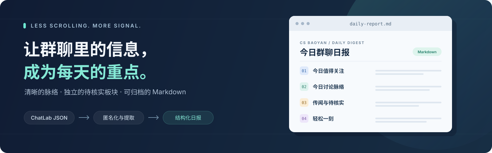
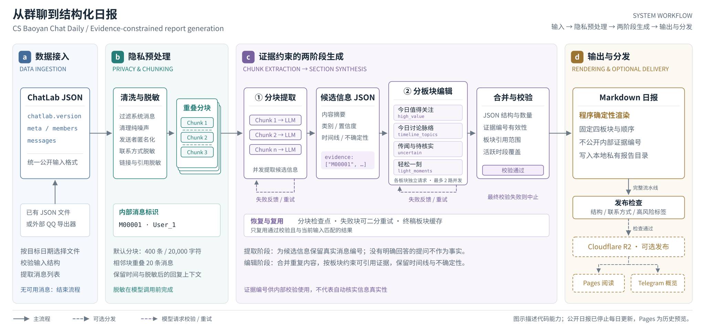

<div align="center">

# CS Baoyan Chat Daily

**从群聊记录到结构化日报，让有价值的信息更容易被看见。**

基于 ChatLab JSON 的 AI 日报生成工具 · 面向 CS 保研场景 · 支持独立部署

[](https://github.com/jielosc/csbaoyan-chat-daily/actions/workflows/test.yml)
[](./pyproject.toml)
[](#日报结构)
[](./LICENSE)

[历史效果预览](https://csbaoyan.icelon.top) · [快速开始](#快速开始) · [工作原理](#工作原理) · [部署指南](./docs/deploy-guide.md)

<br>



</div>

> [!IMPORTANT]
> **公开日报已停止每日更新，生成工具仍可自行使用。** [历史预览站](https://csbaoyan.icelon.top)仅展示过去的生成效果，其中的招生信息可能已经过期。[了解停更说明 →](./docs/pause-update.md)

## 为什么使用它

群聊中的院校信息、申请经验和讨论结论往往散落在大量消息里。本项目将目标日期的 ChatLab 导出整理为固定结构的 Markdown 日报，帮助读者快速抓住重点，也方便后续归档与检索。

| 信息整理 | 隐私处理 | 按需集成 |
| :--- | :--- | :--- |
| 分块提取候选信息，再按板块统一编辑，梳理重点与讨论脉络。 | 模型调用前匿名化发送者、联系方式和链接，发布前检查隐私风险。 | 从本地生成起步，按需接入 QQ 导出、R2、Telegram 和定时任务。 |

- **提取过程可追溯**：内部保留证据编号，校验引用范围与时间线覆盖；公开 Markdown 不包含证据编号。
- **输出结构稳定**：由程序确定性渲染四个板块，执行结构和隐私风险检查。
- **模型服务可配置**：使用 OpenAI 兼容 API，可为最终编辑阶段单独配置模型。

## 日报结构

每份日报默认包含四个板块，让重点、讨论与不确定信息各有位置。

| 板块 | 你会看到什么 |
| :--- | :--- |
| **01 · 今日值得关注** | 院校与项目、申请与考核、经验与选择。 |
| **02 · 今日讨论脉络** | 按时间顺序梳理话题、观点、分歧和阶段性结论。 |
| **03 · 传闻与待核实** | 单一信源、相互矛盾或缺少原始证据的信息。 |
| **04 · 轻松一刻** | 少量脱离上下文仍能理解、不会伤害具体个人的片段。 |

[浏览历史日报，查看实际生成效果 →](https://csbaoyan.icelon.top)

## 快速开始

需要 **Python 3.10+**、一份目标日期的 **ChatLab JSON**，以及可用的 **OpenAI 兼容 API**。仅本地生成不需要 QQ、R2 或 Telegram 配置。

### 1. 安装

在 macOS / Linux 终端运行：

```bash
git clone https://github.com/jielosc/csbaoyan-chat-daily.git
cd csbaoyan-chat-daily

python3 -m venv .venv
source .venv/bin/activate
python -m pip install -e .
cp .env.example .env
chmod 600 .env
```

<details>
<summary>Windows PowerShell 安装命令</summary>

```powershell
git clone https://github.com/jielosc/csbaoyan-chat-daily.git
cd csbaoyan-chat-daily

py -m venv .venv
.\.venv\Scripts\Activate.ps1
python -m pip install -e .
Copy-Item .env.example .env
```

</details>

### 2. 配置模型

编辑 `.env`，填写以下三项：

```dotenv
OPENAI_BASE_URL=https://your-provider.example/v1
OPENAI_API_KEY=your-api-key
OPENAI_MODEL=your-model
```

完整配置项见 [`.env.example`](./.env.example)。如需为最终编辑阶段单独选择模型，可设置 `OPENAI_FINAL_MODEL`。

### 3. 生成第一份日报

将目标日期的文件放入 `chat_exports/`，例如 `chat_exports/chatlab-2026-09-06.json`，然后运行：

```bash
csbaoyan-daily generate \
  --source json \
  --export-dir ./chat_exports \
  --report-dir ./internal/reports \
  --date 2026-09-06
```

日报输出至 **`internal/reports/2026-09-06.md`**。将示例日期替换为你的消息日期；默认按 `Asia/Shanghai` 划分自然日，可通过 `--timezone` 调整。

### 4. 检查生成结果

```bash
csbaoyan-daily verify \
  --report-dir ./internal/reports \
  --date 2026-09-06
```

自动检查后，发布前仍需人工复核内容与隐私。运行 `csbaoyan-daily --help` 查看全部命令，或用 `csbaoyan-daily generate --help` 查看生成参数。

## 工作原理

**ChatLab JSON → 清洗与匿名化 → 分块提取 → 板块编辑与校验 → Markdown 日报**

第一阶段逐块提取带内部证据编号的候选信息；第二阶段按四个板块统一编辑，检查引用范围与时间线覆盖，最后由程序渲染 Markdown。证据校验用于检查引用关系，不能自动证明群聊内容真实。



<details>
<summary>查看高清流程图、图注与可编辑源文件</summary>

[高清 PNG](./docs/figures/workflow.png) · [可编辑 SVG](./docs/figures/workflow.svg) · [图注与生成方式](./docs/figures/README.md)

下载 [HTML 预览页](./docs/figures/workflow.html) 后在本地浏览器打开，可切换原尺寸并查看图注。

</details>

### 输入约定

公开输入边界是 **ChatLab JSON**：

- 文件包含 `chatlab.version`、`meta`、`members` 和 `messages`。
- 每条消息至少包含 `platformMessageId`、`sender`、`timestamp`、`type` 和 `content`。
- 文件名建议包含目标日期，例如 `chatlab-YYYY-MM-DD.json`。

使用 `--source export` 时，本项目编排外部工具 [`qqnt-export-macos`](https://github.com/jielosc/qqnt-export-macos) 的 `export-chatlab` 命令。此模式需要 `QQNT_EXPORT_COMMAND`、`QQNT_KEY_PATH` 和 `QQNT_CONVERSATION_ID`；本项目本身不读取 QQ 数据库，也不解析 QQ 私有消息格式。

## 可选集成

本地生成之外，可以按需串联生成、检查、发布与播报。

| 集成 | 用途 | 配置入口 |
| :--- | :--- | :--- |
| **QQ 自动导出** | 调用外部导出器获取指定自然日的消息；当前导出集成面向 macOS。 | `QQNT_*` |
| **Cloudflare R2** | 上传 Markdown 日报及索引，供预览前端读取。 | `R2_*` |
| **Telegram** | 向频道发送日报概览与链接。 | `TELEGRAM_*`、`SITE_BASE_URL` |
| **定时任务** | 使用 macOS LaunchAgent 或 Windows 任务计划运行流水线。 | [部署指南](./docs/deploy-guide.md) |

配置所需集成后，可以运行完整流水线：

```bash
scripts/daily_pipeline.sh --date 2026-09-06
```

[查看 R2、预览站和定时任务的完整部署说明 →](./docs/deploy-guide.md)

## 文档与开发

| 入口 | 内容 |
| :--- | :--- |
| [部署指南](./docs/deploy-guide.md) | 可选集成配置、历史数据迁移与自动运行。 |
| [配置示例](./.env.example) | 输入、模型服务、发布与播报的环境变量。 |
| [流程图说明](./docs/figures/README.md) | 系统流程图的图注、源文件与重新生成方式。 |
| [停更说明](./docs/pause-update.md) | 公开日报的当前状态与历史背景。 |

<details>
<summary>项目目录与开发检查</summary>

```text
src/csbaoyan_daily/
├── cli.py       # 命令行入口
├── app/         # 生成、校验、发布与流水线编排
├── domain/      # 消息处理、结构化提取与 Markdown 渲染
└── infra/       # 导出器、模型 API、R2 与 Telegram 适配
pages/           # 历史公开数据的静态预览前端
scripts/         # 部署与定时运行脚本
tests/           # Python 与前端测试
docs/            # 部署文档、流程图与素材
```

安装项目依赖后，在仓库根目录执行；前端测试还需要 Node.js，CI 使用 Node.js 22：

```bash
python -m unittest discover -s tests -p 'test_*.py'
node tests/pages-homepage.test.mjs
```

欢迎通过 [Issue](https://github.com/jielosc/csbaoyan-chat-daily/issues) 反馈问题，或提交 Pull Request。复现材料请使用脱敏样例，避免上传真实群聊、联系方式和密钥。

</details>

## 隐私与使用边界

原始消息、脱敏记录、中间结果和最终报告默认保存在被 Git 忽略的私有目录中。仓库不包含公开日报的数据源；`pages/` 只读取历史公开数据。前端代码部署不会触发日报生成，也不会向 R2 写入新数据。

日报由 AI 从群聊中整理，可能存在遗漏或错误。涉及夏令营、预推免、招生制度和导师信息时，请以官方通知及公开资料为准。

匿名化和风险检查只能降低风险，无法保证所有上下文都不可识别。使用者应在发布前人工复核，并妥善保护 ChatLab 导出、`.env` 和私有生成目录。

## License

本项目采用 [MIT License](./LICENSE)。
